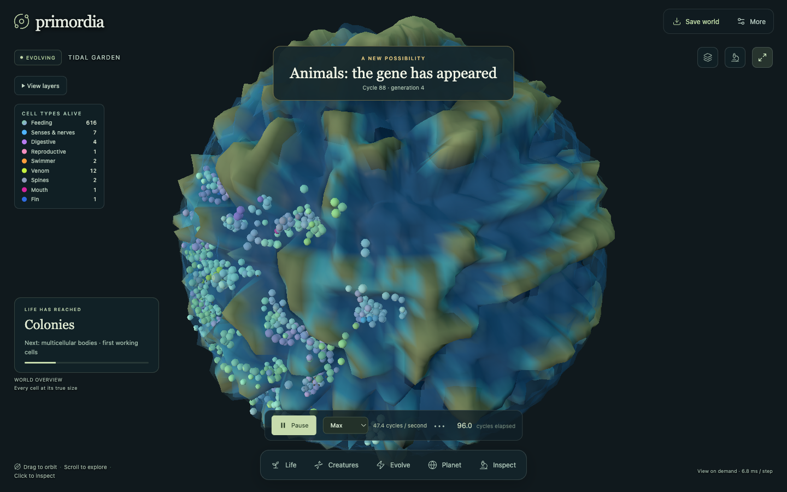
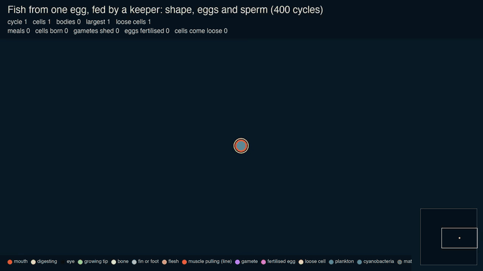
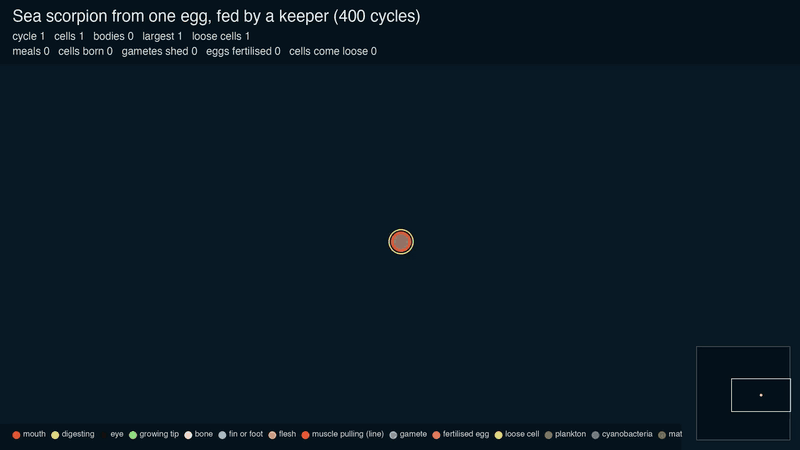
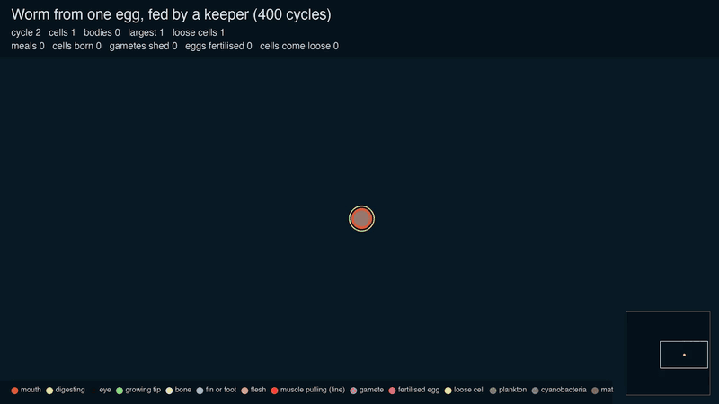
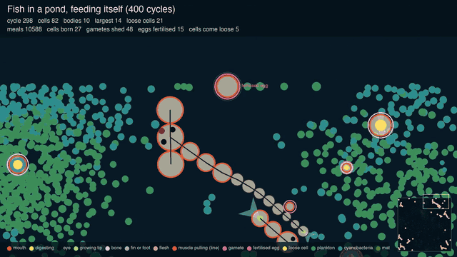
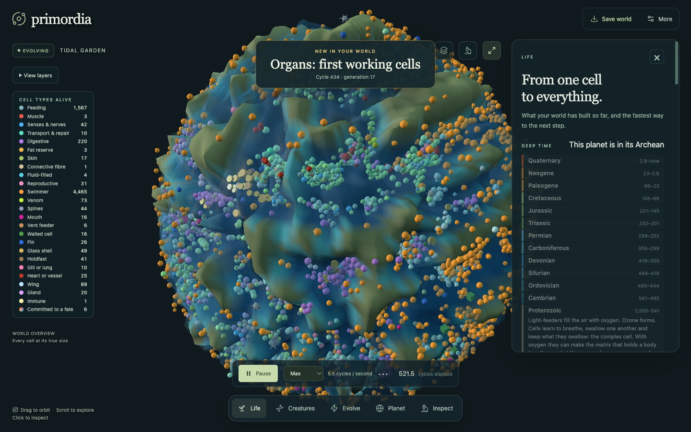

# Primordia

**Plant single cells on a planet. Watch what they become.**

Primordia is a god game and an artificial-life simulator. A Rust engine, compiled to WebAssembly, simulates a small planet: its light, water, minerals and air, and every living cell on it. Nothing alive is scripted. A species is a list of genes, a body is whatever those genes build, and the only thing that decides what lasts is whether it survives and breeds. You steer with a handful of powers and see what the world makes of them.



*A quick-start planet, 96 cycles after 64 single cells were planted. Every dot is a living cell, coloured by the job its genes have given it.*

## Watch a body build itself

This fish starts as one fertilised egg. A growing tip at the tail lays down the body one part at a time. Each part reads where it sits along the body and becomes head, trunk, fin or tail. At cycle 83 it sheds its first eggs and sperm. Where two meet they fuse, and the fertilised egg grows into the next fish.



The same engine, with different genes:

| Sea scorpion | Worm |
| --- | --- |
|  |  |
| Head, three pairs of two-part limbs budded from set places, nine armoured segments tapering to the tail. About 26 parts. | A line of sixteen soft segments, all one size. |

Those three were fed by a keeper so that growth is easy to see. In a pond they have to feed themselves. These fish filter plankton and cyanobacteria through the front third of the body, and the yellow dots are meals being digested:



**How to read these pictures.** They are top-down drawings of engine recordings, made by [`scripts/pond_film.py`](scripts/pond_film.py). Each disc is one part of a body, the lines are the ties that hold parts together, and a tie turns red while its muscle pulls. An orange rim is a mouth, a purple ring is an egg or sperm, a pink ring is a fertilised egg. The eyes, the mouth mark and the tail-fin fan are drawing aids, placed where the body really has those parts.

Full videos, 27 seconds each:

| | Grown from one egg, fed | In a pond, feeding itself |
| --- | --- | --- |
| Fish | [video](docs/media/fish-from-egg.mp4) | [video](docs/media/fish-pond.mp4) |
| Sea scorpion | [video](docs/media/sea-scorpion-from-egg.mp4) | [video](docs/media/sea-scorpion-pond.mp4) |
| Worm | [video](docs/media/worm-from-egg.mp4) | [video](docs/media/worm-pond.mp4) |

## What makes it different

- **Nothing is scripted.** There is no "fish" object. A fish is a few dozen genes, and the body in the clip above is what those genes build when the engine runs them.
- **Matter is conserved.** Food, waste, minerals, remains and water are tracked stores. A corpse returns what it was made of. A meal has to come from somewhere.
- **Survival is the only selector.** The engine awards no fitness score and unlocks no traits. If you want to breed for a purpose, that is a power you use openly, and it works by removing bodies.
- **Laws, not caps.** Where the model needs a limit, the aim is a physical law that life has to adapt to. A mouth cannot catch prey small enough to slip through it. A muscle cannot spend energy a cell does not have.
- **Bodies are built the way embryos build them.** A growing tip lays down segments, cells commit to a fate, limbs bud sideways from set places, and germ cells are set aside to make eggs and sperm. The design notes cite the developmental biology they copy.

## What you can do



*The same kind of planet at cycle 434. The list on the left counts cells by what they do: feeding, swimming, digesting, sensing, breeding.*

The planet fills the screen and five tools sit under it:

- **Life** shows how far your world has climbed, from living cells to colonies, bodies, tissues, senses, muscle, skeleton and hunters, measured from the cells that are alive. It also places your planet in deep time and draws the family trees of the lines each kind has split into.
- **Creatures** lets you plant any of about fifty starter species, from cyanobacteria, diatoms and Volvox to sponges, jellies, trilobites and fish. Each one is a gene list that then has to make its own living.
- **Evolve** holds the powers: set the pace of change, breed for a purpose, favour a lineage, brighten the star, stir the oceans, send rain, an ice age, a mutation storm, a meteor or a great dying.
- **Planet** paints the habitat with brushes and sets climate and seasons.
- **Inspect** opens any cell or body to show its genes and what it is doing.

## How it works

**Genes.** Each gene names an action (photosynthesise, stick to a neighbour, contract, lay down mineral, open a mouth, grow a fin) and a promoter: a bias plus weighted inputs the cell can sense, such as its energy, its age, how many neighbours it is tied to and where it sits along the body. Expression is the clamped sum. A genome holds up to 48 genes. These two lines from the fish put a mouth at the front of the body and muscle everywhere behind it:

```rust
gene(ENGULF, front / 4. - 0.1, 2., &[(AXIAL, -2.), (OUT, -1.5)]),
gene(4, -0.083 - front / 4., 0.8, &[(BONDED, 1.), (AXIAL, 2.)]),
```

**Variation.** Genes change through copying errors at division. Cells can take up a gene from a neighbour of another lineage. Animals shed eggs and sperm, and a fertilised egg carries genes from both.

**Bodies.** Cells are held together by ties that behave as springs. Muscle shortens a tie and pays for the work in energy. Mineral stiffens a body into a skeleton with joints. Water drags on everything that moves. Body mechanics run twenty substeps per tick.

**The planet.** A sphere with terrain, shallow seas, day and night, seasons, rain, snow, evaporation and runoff. Light is the only income a world has, apart from the chemistry at vents. A young planet has no oxygen until light-feeders make it.

The engine is about 26,000 lines of Rust in [`engine/src`](engine/src). The interface is TypeScript and three.js in [`src`](src).

## Run it

You need Node.js 22.12 or newer.

```sh
git clone https://github.com/cadenburleson/primordia.git
cd primordia
npm install
npm run dev
```

Then open http://127.0.0.1:5194/ and choose **Quick start**. On a Mac you can double-click `Primordia.command` instead. A built engine is included, so Rust is only needed to change it.

### Work on the engine

```sh
# Unit tests (186 run, 45 long probes are skipped unless asked for)
cargo test --release --manifest-path engine/Cargo.toml --lib

# Rebuild the WebAssembly the app loads
npm run build:wasm
```

Rebuilding needs the `wasm32-unknown-unknown` Rust target and `wasm-bindgen-cli` version 0.2.114.

### Record your own film

```sh
cd engine
SPECIES=fish NURSERY=1 FILM=/tmp/fish.jsonl cargo test --release --lib -- probe_film --ignored
cd ..
python3 scripts/pond_film.py /tmp/fish.jsonl fish "Fish from one egg"
```

Leave out `NURSERY=1` for a pond where the animals feed themselves. Drawing needs Pillow and ffmpeg.

## Where it stands

This is a research project in motion, and plenty does not work yet.

Measured over 400 cycles:

| | Grown from one egg, fed | In a pond, feeding itself |
| --- | --- | --- |
| Fish | One body of 12 parts, first gametes at cycle 83. By cycle 400: 345 cells in 49 bodies, 70 eggs fertilised. | 72 cells grow to 83. 51 gametes shed, 17 eggs fertilised. Some adults shrink from 12 parts to 7. |
| Sea scorpion | One body of 26 parts, first gamete at cycle 354. | 80 cells grow to 186. 6 gametes, none fertilised. Adults drop from 20 parts to 16 or fewer. |
| Worm | One line of 16 segments. | Five bodies of 11 that stay whole. 5 gametes, none fertilised. No growth. |

Known to be wrong or missing:

- One body's own eggs and sperm can fuse with each other. There are no sexes yet, and eggs and sperm are the same size.
- A fish in a pond takes in about four fifths of what it burns, which is why adults lose parts.
- The sea scorpion filters plankton like the others. A hunter needs a jaw and prey worth catching.
- The worm has no skeleton to bend against and barely moves.
- Only the fish, sea scorpion and worm are built as shaped bodies so far. The trilobite and the rest of the animals are still built the older way, as clumps.
- The app slows as life spreads. On one laptop it ran about 45 cycles a second with 650 cells and about 5 with 7,000.

## Read more

- [Early Earth and the road life took](docs/EARLY_EARTH.md): the research the planet is built from, and the build order.
- [Animal bodies that travel, eat and breed](docs/ANIMAL_BODIES_PLAN.md): how bodies, muscle, eggs and sperm are built, with sources.
- [Creator powers, life's ascent and speed](docs/CREATOR_POWERS.md): what each power does and what was measured.
- [Architecture](docs/ARCHITECTURE.md): how the interface, the worker and the engine fit together.
- The rest of [`docs/`](docs) holds earlier design notes and validation records. Some describe older versions of the engine.

## Layout

```text
engine/      Rust simulation engine and its tests
src/         Browser interface, renderer, worker and the built WebAssembly
docs/        Research, design notes and measurements
scripts/     Engine build script and the film drawer
tests/       Checks run against the built engine
examples/    Saved worlds you can open in the app
archive/     Two earlier versions, kept for reference
```

## License

[MIT](LICENSE)
